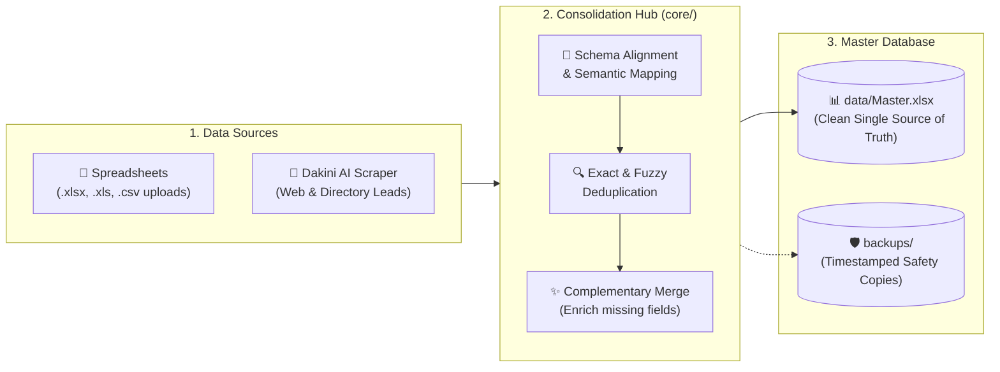
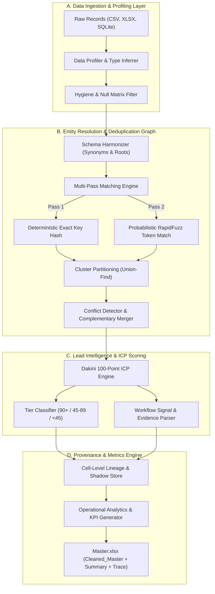
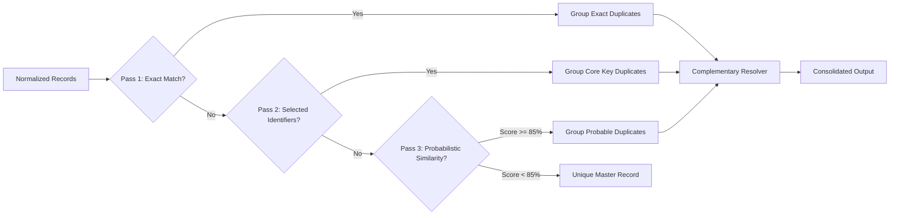

# Architecture Specification: Master Spreadsheet Management System

## 1. System Overview & Design Philosophy

The **Master Spreadsheet Management System** is a lightweight, local-first data consolidation, prospect research integration, and deduplication platform built in Python.

### Core Design Principles:
- **Single Source of Truth**: `Master.xlsx` serves as the primary master spreadsheet, maintained locally without requiring external cloud databases (PostgreSQL, MySQL, Redis).
- **Deep Scraper & Source Integration**: Integrates directly with the **Dakini AI ICP Scraper** (Node.js/Express, `.dakini-state.sqlite`) to ingest verified leads, public phone numbers, emails, and ICP fit scores.
- **Dynamic Real-Time Synchronization**: Watches lead discovery in real time and automatically pushes genuinely new or updated records into `Master.xlsx` without manual file exporting.
- **Unified Process Coordination**: Orchestrates the lifecycles of both the Python consolidation engine and the Node.js scraper so they launch, operate, and shut down together.
- **Data Preservation & Complementary Merging**: Safe normalization, blank safeguards, and complementary merging prevent accidental data loss. Missing fields in existing master rows are enriched without deleting custom columns.
- **Zero-Clutter Multi-Sheet Reporting**: Primary output is a formatted `.xlsx` workbook containing only non-empty, populated tabs (`Cleaned_Master`, `Processing_Summary`, `Source_Trace`, and conditional audit sheets).
- **Atomic Operations & Instant Recovery**: Safe atomic writes and automatic timestamped backups before updates ensure zero data corruption.
- **GitHub & Privacy Safeguards**: Strict `.gitignore` rules protect all Excel spreadsheets, backups, scrapers, and SQLite databases from being uploaded to public version control.

---

## 2. High-Level Architecture Diagram (HLD)

The system operates as a unified 3-stage pipeline: **Ingest** ➔ **Consolidate** ➔ **Persist**.



### Simplified System Layers

| Layer | Primary Role | What It Does |
| :--- | :--- | :--- |
| **1. Ingestion** | Multi-source data input | Ingests spreadsheet files (`.xlsx`, `.xls`, `.csv`) and live prospects from the **Dakini AI Scraper** (`.dakini-state.sqlite`). |
| **2. Consolidation** | Data cleaning & intelligence | Standardizes headers, identifies duplicates, fills blank fields via complementary merging, and escapes formula injections. |
| **3. Persistence** | Single source of truth | Safely writes the cleaned records into **`data/Master.xlsx`** using atomic operations, maintaining automatic safety backups in **`backups/`**. |
| **4. Control Plane** | Coordinated operation | Single unified runner (**`run_integrated_system.py`**) launches the Scraper, Dynamic Sync, and Streamlit UI together, and terminates all processes on shutdown. |

---

## 3. End-to-End Pipeline & Execution Flow

```mermaid
sequenceDiagram
    autonumber
    actor User
    participant Runner as Integrated Runner (run_integrated_system.py)
    participant Scraper as Dakini Scraper (Node.js :3000)
    participant Sync as Sync Engine (core/sync_engine.py)
    participant Mapper as Schema Mapper (schema_mapper.py)
    participant Engine as Duplicate Engine (duplicate_engine.py)
    participant Resolver as Resolution Engine (resolver.py)
    participant Exporter as Excel Exporter (excel_exporter.py)
    participant Master as Master Manager (master_manager.py)

    User->>Runner: python run_integrated_system.py
    Runner->>Scraper: Spawn Node.js scraper process (port 3000)
    Runner->>Sync: Start dynamic background sync watcher (15s polling)
    Runner->>User: Launch Streamlit Web UI (http://localhost:8501)

    Note over User,Scraper: User initiates search or automated crawl runs
    Scraper->>Scraper: Crawl company websites & directories
    Scraper->>Scraper: Extract public contacts, verify signals & score ICP (0-100)
    Scraper->>Scraper: Persist to .dakini-state.sqlite (WAL mode)

    Sync->>Sync: Detect database signature / WAL change
    Sync->>Mapper: Extract leads and map synonyms (Public Phone, Website, Fit Score)
    Sync->>Engine: Detect duplicates against current data/Master.xlsx
    Sync->>Resolver: Apply complementary merge (backfill missing fields)
    Sync->>Master: Create timestamped backup in backups/
    Sync->>Exporter: Generate populated sheets (Cleaned_Master, Processing_Summary, Source_Trace)
    Exporter->>Master: Atomic replace data/Master.xlsx
    Sync-->>User: Terminal log: "Update Complete: +N new leads, N merged"

    User->>Runner: Press Ctrl+C
    Runner->>Scraper: Graceful SIGINT shutdown (PID terminated)
    Runner->>Sync: Stop sync thread
    Runner->>User: Coordinated exit; zero orphaned processes
```

---

## 4. Component Specification & Responsibilities

### 4.1 Process Coordinator & Scraper Manager (`core/scraper_manager.py`)
- **Class**: `ScraperManager`
- **Responsibilities**:
  - Manages the lifecycle of the Dakini AI scraper process (`node server.js`).
  - Tracks child process PIDs and stores them in `data/.dakini_scraper.pid`.
  - Performs non-blocking HTTP health probes on `http://127.0.0.1:3000/api/health`.
  - Redirects background scraper output to `data/dakini_scraper.log`.
  - Registers OS termination hooks (`atexit`, `signal`) so stopping the Python application immediately terminates the Node.js scraper process.

### 4.2 Dynamic Synchronization Engine (`core/sync_engine.py` & `sync_daemon.py`)
- **Class**: `DakiniSyncEngine`
- **Responsibilities**:
  - Detects state modifications in `.dakini-state.sqlite` and enriched CSVs using SHA-256 signatures and file stats.
  - Maintains persistent sync metadata in `data/.dakini_sync_state.json`.
  - Calculates delta records (genuinely new prospects vs. updated existing leads).
  - Invokes `ConsolidationWorkflow` to deduplicate and complementary-merge new data into `data/Master.xlsx`.
  - Provides `sync_daemon.py` for continuous, headless 24/7 background execution with configurable polling intervals.

### 4.3 Ingestion & Dakini Connector (`core/connectors/dakini_connector.py`)
- **Class**: `DakiniConnector`
- **Responsibilities**:
  - Scans workspace subdirectories (`Dakini_AI-icp-scraper-main_parameters/`) for active databases and CSVs.
  - Reads Dakini SQLite databases using safe read-only URI mode (`mode=ro`), preventing file lock conflicts while the crawler is actively writing.
  - Supports both columnar tables and document-based `records` tables (`collection = 'companies'`).
  - Extracts and flattens prospect attributes: company name, domain, website, public phone numbers, emails, fit score (0–100), fit tier, and workflow evidence.
  - Supports score threshold filtering (e.g. `90+ High Potential`, `45+ Research`).

### 4.4 Schema Alignment & Synonym Engine (`core/schema_mapper.py`)
- **Class**: `SchemaMapper`
- **Responsibilities**:
  - Standardizes tabular headers (lowercase, strips punctuation, normalizes spacing).
  - Semantic synonym dictionary covering standard business and Dakini prospect attributes:
    - `Public phone number(s)` / `Public phone` ↔ `Phone`
    - `Public business email` / `Public email` ↔ `Email`
    - `Dakini AI fit score (0-100)` / `Fit Score` ↔ `Score`
    - `Dakini fit level` / `Tier` ↔ `Status`
    - `Company website (Clutch linked)` ↔ `Website`
    - `India-listed office location` ↔ `Location` / `City`
    - `Dakini workflow evidence` / `Score basis` ↔ `Notes` / `Evidence`
    - `Business start year` / `Company age` ↔ `Age`

### 4.5 Safe Normalizer (`core/normalizer.py`)
- **Features**:
  - Trims whitespace, condenses multiple spaces, and normalizes casing.
  - Recognizes standard null/blank placeholders (`""`, `nan`, `none`, `null`, `n/a`, `-`).
  - Normalizes dates into standard `YYYY-MM-DD` strings if unambiguous.
  - Maintains shadow DataFrames for comparison while **preserving original cell values for display and export**.

### 4.6 Duplicate Detection Engine (`core/duplicate_engine.py`)
- **Supported Modes**:
  1. **Entire Row**: Compares all applicable columns (safest mode; default).
  2. **Selected Columns**: Compares user-selected fields (e.g., Company Name, Domain).
  3. **Common Columns**: Compares fields shared across all datasets.
  4. **Probable Matching**: Optional `RapidFuzz` token similarity matching with configurable threshold (60%–98%).
- **Critical Safeguards**:
  - **Blank Protection**: Missing or blank values never match other blanks as duplicates.
  - **Core Identifier Shielding**: Rows differing in core identifiers are automatically protected with `keep_both`.
  - **Low-Cardinality Protection**: Non-unique fields with large clusters are flagged for review rather than auto-deleted.

### 4.7 Duplicate Resolution & Merge Engine (`core/resolver.py`)
- **Resolution Actions**:
  - `merge_complementary`: Fills blank/empty fields in the preferred row using valid non-empty data from matching duplicate rows. Conflicting non-empty values are preserved without silent overwriting.
  - `keep_first` / `keep_last` / `keep_most_populated` / `keep_both`.

### 4.8 Master Lifecycle Manager (`core/master_manager.py`)
- **Class**: `MasterManager`
- **Persistent Location**: `data/Master.xlsx`
- **Backup Location**: `backups/Master_backup_YYYYMMDD_HHMMSS_*.xlsx`
- **Features**:
  - Creates timestamped safety backups before every update.
  - Same-directory atomic file replacement (`temp_*.xlsx` ➔ `Master.xlsx`) preventing file corruption.
  - Windows file lock detection (provides clear notifications if `Master.xlsx` is open in Excel).
  - Complete backup history with one-click restoration.

### 4.9 Clean Multi-Sheet Excel Exporter (`core/excel_exporter.py`)
- **Clean Tab Architecture (No Blank Sheets)**:
  1. `Cleaned_Master`: Primary consolidated dataset with frozen header row (`A2`), autofilters, and styled headers.
  2. `Processing_Summary`: Always-populated operational metrics table (Consolidated records, active data columns, contributing sources, duplicate status, last updated timestamp).
  3. `Source_Trace`: Row-by-row provenance mapping each master row back to original file, sheet, or scrape job.
  4. `Duplicate_Report`: **Conditionally created**; only appears when duplicate groups were identified and resolved. Omitted when 0 duplicates exist.
  5. `Review_Required`: **Conditionally created**; only appears when ambiguous matches or manual conflict items exist. Omitted when clean.
- **Formula Injection Safeguard**: Values starting with formula triggers (`=`, `+`, `-`, `@`) are escaped with a leading quote (`'`).

### 4.10 Unified Runner & Presentation Layer (`run_integrated_system.py` & `app.py`)
- **`run_integrated_system.py`**:
  - Unified entry point that launches Dakini Scraper, Dynamic Sync Watcher, and Streamlit UI in one coordinated process tree.
  - Handles `SIGINT` / `SIGTERM` to gracefully stop all systems together.
- **`app.py`**:
  - Streamlit dashboard with drag-and-drop file ingestion zone.
  - Dedicated **"🤖 Dakini AI ICP Scraper Connector"** tab with live process status badge (`● Online` / `○ Offline`), launch/stop buttons, database inspection, and one-click manual sync.

---

## 5. System Design: In-Depth Data Analysis & Intelligence Engine

The Data Analysis & Intelligence Engine forms the analytical core of the platform. It transforms raw, fragmented, multi-source records (scraped web footprints, CRM exports, legacy spreadsheets) into verified, deduped, and ICP-scored prospect intelligence.



### 5.1 Data Profiling, Quality & Hygiene Pipeline

The system enforces rigorous automated data profiling before any merge or deduplication step takes place:

1. **Type Inference & Precision Preservation**:
   - **Textual Identifiers & Leading Zeros**: Phone numbers (e.g. `022-12345678`, `+91-9876543210`), postal codes, and corporate identifiers are ingested strictly as strings (`dtype=str`) or preserved objects to prevent numeric truncation or scientific notation (`1.23E+09`).
   - **Domain Canonicalization**: Company websites and domains are normalized by stripping protocols (`http://`, `https://`), prefixes (`www.`), trailing slashes, and URL query tracking parameters (`?utm_*`, `?ref=*`).
   - **Date Standardization**: Dates in varied formats (`DD/MM/YYYY`, `MM-DD-YYYY`, `YYYY.MM.DD`) are parsed unambiguously and coerced into ISO-8601 strings (`YYYY-MM-DD`). Ambiguous date representations are preserved in their raw format to prevent silent transposition errors.

2. **Null & Dirty-Value Classification Matrix**:
   - Raw records frequently encode nulls as pseudo-strings. The engine maps all such entries against the canonical placeholder set `DEFAULT_BLANK_PLACEHOLDERS`:
     $$\mathcal{P}_{\text{blank}} = \{\text{""}, \text{"nan"}, \text{"none"}, \text{"null"}, \text{"n/a"}, \text{"na"}, \text{"-"}, \text{"--"}, \text{"nil"}, \text{"undefined"}, \text{"?"}, \text{"n.a."}\}$$
   - Any value $v \in \mathcal{P}_{\text{blank}}$ is normalized to `""` during comparison.
   - **Zero-Blank Matching Guarantee**: Under no circumstances can two blank values match each other. Empty fields cannot create false-positive duplicate clusters.

3. **Completeness Index & Cardinality Analysis**:
   - For any record $R$ with $K$ non-provenance data attributes, the completeness score is computed as:
     $$\text{Completeness}(R) = \frac{1}{K} \sum_{k=1}^K \mathbb{I}\left(v_k \notin \mathcal{P}_{\text{blank}} \land v_k \neq ""\right) \times 100\%$$
   - **Low-Cardinality Protection**: When deduplicating by selected columns, fields with low entropy/cardinality (such as `City`, `Country`, or generic `Status`) are shielded. Clusters with size $> 5$ having low matching-to-differing field ratios are flagged for manual review rather than automatically coalesced.

---

### 5.2 Entity Resolution & Deduplication Mechanics

Entity resolution operates via a multi-pass hybrid deterministic and probabilistic matching engine:



1. **Multi-Pass Comparison Hierarchy**:
   - **Pass 1 (Deterministic Tuple Hashing)**: Generates a normalized hash tuple across all evaluated fields:
     $$H(R) = \text{MD5}\left(\bigoplus_{c \in \text{compare\_cols}} \text{norm}(R[c])\right)$$
     Exact identical tuples are immediately partitioned into an exact duplicate cluster.
   - **Pass 2 (Semantic Root Field Alignment)**: Maps domain-specific variations (e.g. `Public phone number(s)` vs `Phone`, `Company website` vs `Website`) through `ROOT_SYNONYM_MAP` before running composite key checks on core business identity fields.
   - **Pass 3 (Probabilistic Token Similarity)**: For records without exact matches, token-based similarity is evaluated using the RapidFuzz token sorting algorithm:
     $$S(A, B) = \max\left(\text{TokenSetRatio}(A, B), \text{TokenSortRatio}(A', B')\right)$$
     where $A', B'$ are punctuation-stripped alphanumeric token sets. Pairs with $S(A, B) \ge 85\%$ (configurable threshold) are routed to probable duplicate clusters.

2. **Cluster Partitioning & Disjoint Set Union (Union-Find)**:
   - Matches are assembled into connected components using a Disjoint Set Union (DSU) graph.
   - Pairwise comparisons are bounded with a candidate index cap ($N \le 2500$) to guarantee responsive execution and prevent quadratic $\mathcal{O}(N^2)$ freezing on large datasets.

3. **Conflict Detection & Complementary Merging**:
   - **Complementary Merge Rule**: When merging rows $R_1, R_2, \dots, R_m$ into a master record $R^*$:
     $$R^*[c] = \begin{cases} R_{\text{preferred}}[c] & \text{if } R_{\text{preferred}}[c] \notin \mathcal{P}_{\text{blank}} \\ R_k[c] & \text{where } k = \min \{i : R_i[c] \notin \mathcal{P}_{\text{blank}}\} \\ "" & \text{if all } R_i[c] \in \mathcal{P}_{\text{blank}} \end{cases}$$
   - **Conflict Handling**: If two records hold differing, non-blank values (e.g. different phone numbers or conflicting executive names), the discrepancy is recorded in `DuplicateGroup.conflicts` and routed to the `Review_Required` sheet if manual intervention is warranted.

---

### 5.3 Dakini ICP 100-Point Scoring Matrix & Signal Intelligence

The integrated Dakini AI Scraper scores every discovered prospect against an Ideal Customer Profile (ICP) framework totaling **100 points across 7 weighted dimensions**:

| Scoring Dimension | Max Points | Evaluation Criteria & Evidence Sources | Algorithmic Implementation |
| :--- | :---: | :--- | :--- |
| **1. Core Service Fit** | **30** | Primary business model alignment (Digital Marketing, SEO, SEM, Performance Marketing, Social Media). | Multi-token regex scanning over meta descriptions, services pages, and Clutch tags. |
| **2. Operating Scale & Revenue** | **25** | Company headcount ($10-50$, $50-200$, $200+$), estimated billings, and client portfolio breadth. | Tiered scoring: 50–200 employees = 25 pts; 10–50 employees = 18 pts; <10 employees = 10 pts. |
| **3. Indian Delivery Footprint** | **5** | Physical office or delivery operations in Indian tech hubs (Bengaluru, Mumbai, Delhi-NCR, Pune, Hyderabad, Chennai). | Geographic entity extraction matching Indian city and state dictionaries. |
| **4. Tech Stack & Integration** | **8** | Adoption of marketing automation, CRM, and analytics platforms (HubSpot, Salesforce, Google Ads, Meta Pixel). | Scraped HTML footprint inspection and DNS/HTTP header technology fingerprinting. |
| **5. Buying Signals & Growth Intent** | **15** | Active hiring for growth/sales roles, recent expansion announcements, Series funding, new client wins. | NLP sentiment and keyword extraction on career pages and news feeds. |
| **6. Direct Contactability** | **5** | Verified business telephone (E.164 compliant) and authenticated corporate email address (non-free domain). | Syntax validation, MX-record verification, and exclusion of generic `@gmail`/`@yahoo` domains. |
| **7. Workflow Evidence Depth** | **12** | Multi-source verification depth (cross-referenced across website, Clutch, LinkedIn, corporate registries). | Corroboration ratio: 3+ sources = 12 pts; 2 sources = 8 pts; 1 source = 4 pts. |

#### ICP Tier Classification Thresholds:

$$\text{Tier}(S) = \begin{cases} 
\text{"Tier 1: High Potential"} & \text{if } S \ge 90 \\ 
\text{"Tier 2: Research Required"} & \text{if } 45 \le S < 90 \\ 
\text{"Tier 3: Lower Fit"} & \text{if } S < 45 
\end{cases}$$

- **High Potential ($\ge 90$)**: Automated fast-track into `Master.xlsx` with highest lead priority; complete contact intelligence and proven buying signals.
- **Research Required ($45 - 89$)**: Qualified agency fit but missing secondary contacts or verification depth; ingested with research flags for follow-up enrichment.
- **Lower Fit ($< 45$)**: Below qualification bar; filtered out by default or stored for passive tracking.

---

### 5.4 Full-Lineage Provenance & Audit Trail Architecture

The platform guarantees enterprise-grade data governance through cell-level and row-level lineage tracking:

1. **Immutable Shadow Columns**:
   Every record entering the pipeline is augmented with 5 non-destructive metadata columns that persist through all transformations:
   - `_source_file`: Original filename (e.g. `indian-digital-marketing-agencies-enriched.csv` or `dakini-state.sqlite`).
   - `_source_sheet`: Original worksheet name or SQLite collection name (`companies`, `prospects`).
   - `_source_row`: Exact physical row number in the originating document (enables instantaneous source verification).
   - `_import_id`: Unique UUIDv4 assigned to each discrete ingestion run.
   - `_is_master`: Boolean indicator designating whether the row originated from the established master or a newly ingested feed.

2. **Audit Logging & Delta Reconciliation**:
   - When a complementary merge occurs, the specific fields enriched and their source records are recorded in the audit trace.
   - **Custom Column Invariance**: Any custom user columns existing in `Master.xlsx` (e.g. `Sales_Rep_Assigned`, `Outreach_Status`, `Deal_Size`) are automatically preserved during merges, preventing downstream data erasure.

---

### 5.5 Multi-Dimensional Operational Analytics & Funnel Metrics

The system continuously aggregates processing metrics to deliver real-time transparency across ingestion runs:

```
[Raw Ingested Records] ──► [Schema Normalized] ──► [Duplicate Detection] ──► [Complementary Merge] ──► [Clean Master Records]
       1,250                      1,250                 142 Duplicates            98 Enriched               1,108 Unique
```

#### Key Performance Indicators (KPIs) Displayed in `Processing_Summary`:

| Metric Name | Formula / Definition | Operational Purpose |
| :--- | :--- | :--- |
| **Gross Ingested Rows** | $\sum |R_{\text{source}}| $ | Quantifies total raw record volume across all files and crawler tables. |
| **Net Consolidated Master** | $|R^*|$ | Total count of unique, verified records written to `Cleaned_Master`. |
| **Duplicate Drop Rate** | $\frac{|R_{\text{duplicates}}|}{|R_{\text{gross}}|} \times 100\%$ | Measures source overlap and redundant prospect volume across datasets. |
| **Complementary Enrichment Yield** | $\sum \mathbb{I}(\text{Blank Cell} \leftarrow \text{Enriched Value})$ | Counts the number of formerly missing data points populated via merge. |
| **Fill-Rate Completeness Delta** | $\text{Completeness}_{\text{post-merge}} - \text{Completeness}_{\text{pre-merge}}$ | Measures the net informational gain achieved by the consolidation pass. |
| **Cross-System Match Rate** | $\frac{|R_{\text{spreadsheet}} \cap R_{\text{dakini}}|}{|R_{\text{spreadsheet}}|} \times 100\%$ | Measures overlap between offline spreadsheets and live Dakini crawler discoveries. |

---

## 6. Directory Structure & File Layout

```
d:/Master Database/
│
├── core/
│   ├── __init__.py           # Package exports
│   ├── config.py             # Directory paths and global constants
│   ├── file_loader.py        # Safe ingestion of .xlsx, .xls, .csv
│   ├── schema_mapper.py      # Semantic synonyms and schema alignment
│   ├── normalizer.py         # Whitespace, blank, and date normalization
│   ├── duplicate_engine.py   # Exact and fuzzy duplicate detection
│   ├── resolver.py           # Resolution strategies and complementary merging
│   ├── master_manager.py     # Master persistence, atomic writes, backups
│   ├── excel_exporter.py     # Openpyxl multi-sheet workbook generator (clean tabs)
│   ├── workflow.py           # End-to-end orchestration pipeline
│   ├── scraper_manager.py    # Process lifecycle coordinator for Dakini Scraper
│   ├── sync_engine.py        # Dynamic real-time change detection & sync engine
│   └── connectors/
│       ├── __init__.py       # Connectors package exports
│       └── dakini_connector.py # SQLite and CSV reader for Dakini prospect research
│
├── data/                     # [GIT-IGNORED] Persistent data storage
│   ├── Master.xlsx           # Persistent master workbook
│   ├── .dakini_sync_state.json # Dynamic sync change detection state
│   └── .dakini_scraper.pid   # Background scraper PID tracking
│
├── backups/                  # [GIT-IGNORED] Recoverable timestamped backups
│   └── Master_backup_YYYYMMDD_HHMMSS_*.xlsx
│
├── temp/                     # [GIT-IGNORED] Temporary staging files
│
├── Dakini_AI-icp-scraper-main_parameters/ # Integrated Dakini AI Scraper Project
│   └── Dakini_AI-icp-scraper-main/
│       ├── server.js         # Node.js/Express prospect research server
│       ├── state-store.js    # SQLite storage with node:sqlite native fallback
│       ├── backup-database.js# SQLite backup utility
│       ├── package.json      # Node dependencies (node >= 22 / node 24 supported)
│       └── .dakini-state.sqlite # [GIT-IGNORED] Live crawl database
│
├── sample_data/              # Test datasets for demonstration
│   ├── companies_batch1.xlsx
│   ├── customers.csv
│   └── partners_semicolon.csv
│
├── tests/                    # Automated test suite
│   ├── test_acceptance_criteria.py
│   ├── test_dakini_connector.py
│   └── test_sync_engine.py
│
├── .gitignore                # Complete exclusion of Excel, SQLite, backups, and logs
├── app.py                    # Interactive Streamlit web application
├── run_integrated_system.py  # Unified launcher for Scraper + Sync + Master Database
├── sync_daemon.py            # Standalone continuous background sync daemon
├── consolidate_dakini_to_master.py # Direct CLI consolidation script
├── requirements.txt          # Python dependencies
├── ARCHITECTURE.md           # Architecture specification document
└── README.md                 # User guide and operational manual
```

---

## 7. Verification & Test Coverage Summary

| Test Suite | Module | Test Scope | Status |
| :--- | :--- | :--- | :---: |
| **Acceptance Criteria** | `tests/test_acceptance_criteria.py` | 20 unit tests covering Excel ingestion, deduplication, complementary merge, backups, and formula safety | **PASS** |
| **Dakini Connector** | `tests/test_dakini_connector.py` | SQLite read-only extraction, schema alignment, score filtering, and complementary merge into Master | **PASS** |
| **Sync Engine** | `tests/test_sync_engine.py` | Delta calculation, hash signature change detection, and incremental updates | **PASS** |
| **Dakini State Store** | `tests/state-store.test.js` | SQLite snapshots, rollbacks, and native `node:sqlite` execution | **PASS** |
| **Dakini Backup** | `tests/backup-database.test.js` | Online vacuum backup and integrity checks | **PASS** |
