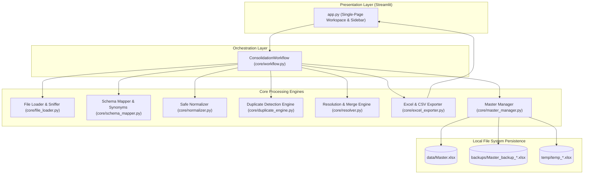
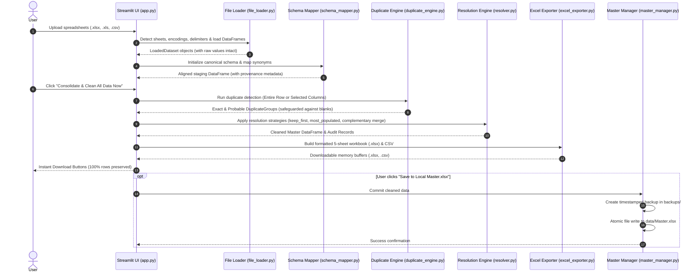

# Architecture Specification: Master Spreadsheet Management System

## 1. System Overview & Design Philosophy

The **Master Spreadsheet Management System** is a lightweight, local-first data consolidation and deduplication platform built in Python. 

### Core Design Principles:
- **No External Database**: Operates without SQLite, PostgreSQL, MySQL, Redis, or an API server.
- **Single Source of Truth**: `Master.xlsx` serves as the primary master file.
- **Data Preservation**: Safe normalization, blank safeguards, and low-cardinality protection prevent accidental deletion of unique records.
- **Multi-Sheet Report Generation**: Primary output is a formatted `.xlsx` workbook containing the cleaned master dataset alongside audit logs, reconciliation summaries, review items, and source provenance.
- **Atomic Operations & Instant Recovery**: Safe atomic writes and automatic timestamped backups before updates ensure zero data corruption.

---

## 2. High-Level Architecture Diagram



---

## 3. End-to-End Pipeline & Execution Flow



---

## 4. Component Specification & Responsibilities

### 4.1 Presentation Layer (`app.py`)
- **Technology**: Streamlit.
- **Responsibilities**:
  - Drag-and-drop ingestion zone for multi-format spreadsheet uploads.
  - Live file metrics (filename, size, row counts, detected sheets).
  - Target master mode selector (`fresh` vs `merge`).
  - Single-click **"Consolidate & Clean All Data Now"** primary execution.
  - Three reconciliation metric cards: **Input Rows Read**, **Duplicates Removed**, **Cleaned Master Rows**.
  - Direct download controls for formatted `.xlsx` and flat `.csv`.
  - Sidebar administration for inspecting `data/Master.xlsx`, downloading disk master, restoring from backups, and resetting.

### 4.2 Orchestration Layer (`core/workflow.py`)
- **Class**: `ConsolidationWorkflow`
- **Responsibilities**:
  - Connects the file loader, schema mapper, normalizer, duplicate engine, resolver, and master manager into a single pipeline.
  - Tracks staging DataFrames, duplicate groups, provenance metadata, audit records, and processing summary statistics.

### 4.3 Ingestion & Inspection Engine (`core/file_loader.py`)
- **Supported Formats**: Excel `.xlsx` (Openpyxl), Legacy Excel `.xls` (xlrd), CSV `.csv`.
- **Key Features**:
  - Worksheets auto-inspection with selective multi-sheet loading.
  - CSV encoding detection (`utf-8`, `utf-8-sig`, `cp1252`, `latin1`, `iso-8859-1`).
  - CSV delimiter sniffing (`,`, `;`, `\t`, `|`).
  - Preserves digit strings (phone numbers, account numbers, postal codes with leading zeros).

### 4.4 Schema Alignment & Synonym Engine (`core/schema_mapper.py`)
- **Class**: `SchemaMapper`
- **Features**:
  - Standardizes header strings (lowercase, strips punctuation, normalizes spacing).
  - Semantic synonym dictionary covering common business terms (e.g. `Company Name` ↔ `Business Name`, `Phone` ↔ `Contact Number`, `Email` ↔ `Email Address`, `Website` ↔ `URL`).
  - Root token matching (e.g. `Public emails` ↔ `Email`, `India office (city-level)` ↔ `City`).
  - Preserves unique/unmapped columns separately.

### 4.5 Safe Normalizer (`core/normalizer.py`)
- **Features**:
  - Trims whitespace, condenses multiple spaces, and normalizes casing.
  - Recognizes standard null/blank placeholders (`""`, `nan`, `none`, `null`, `n/a`, `-`).
  - Parses dates into standard `YYYY-MM-DD` strings if unambiguous.
  - Maintains separate normalized shadow DataFrames for comparison while **preserving original cell values for display and export**.

### 4.6 Duplicate Detection Engine (`core/duplicate_engine.py`)
- **Supported Modes**:
  1. **Entire Row**: Compares all applicable columns (safest mode; default).
  2. **Selected Columns**: Compares user-selected fields (e.g., ID, Email).
  3. **Common Columns**: Compares fields shared across all datasets.
  4. **Probable Matching**: Optional `RapidFuzz` token similarity matching with configurable threshold (60%–98%).
- **Critical Safeguards**:
  - **Blank Protection**: Missing or blank values never match other blanks as duplicates.
  - **Core Identifier Shielding**: If rows differ in core identifying columns (Company Name, Person Name, Title, ID), they are automatically protected with `keep_both`.
  - **Low-Cardinality Protection**: Groups larger than 5 rows on non-unique fields are flagged for review rather than auto-deleted.

### 4.7 Duplicate Resolution & Merge Engine (`core/resolver.py`)
- **Resolution Actions**:
  - `keep_first`: Retains the first occurrence in the duplicate group.
  - `keep_last`: Retains the last occurrence in the duplicate group.
  - `keep_most_populated`: Retains the row with the highest number of non-blank fields.
  - `manual_select`: User manually selects the preferred row.
  - `keep_both`: Retains all rows (marks as non-duplicate).
  - `merge_complementary`: Fills blank/empty fields in the preferred row using valid non-empty data from matching duplicate rows. Conflicting non-empty values are preserved without silent overwriting.

### 4.8 Master Lifecycle Manager (`core/master_manager.py`)
- **Class**: `MasterManager`
- **Persistent Location**: `data/Master.xlsx`
- **Backup Location**: `backups/Master_backup_YYYYMMDD_HHMMSS_*.xlsx`
- **Features**:
  - Creates timestamped safety backups before every update.
  - Same-directory atomic file replacement (`temp_*.xlsx` ➔ `Master.xlsx`) preventing file corruption.
  - Complete backup history with one-click restoration.

### 4.9 Excel & CSV Exporter (`core/excel_exporter.py`)
- **Multi-Sheet Openpyxl Generator**:
  1. `Cleaned_Master`: Deduplicated, consolidated dataset with frozen header row (`A2`), autofilters, and styled headers.
  2. `Duplicate_Report`: Complete audit log with group IDs, confidence scores, matched fields, differences, and actions taken.
  3. `Processing_Summary`: Two-column reconciliation metrics table.
  4. `Review_Required`: Uncertain probable matches, conflicts, and items requiring manual decisions.
  5. `Source_Trace`: Maps each master row back to original file, sheet, and source row number.
- **Formula Injection Safeguard**: Values starting with formula triggers (`=`, `+`, `-`, `@`) are escaped with a leading quote (`'`).
- **CSV Export**: Cleaned flat table exported in UTF-8 with user-selected delimiters.

---

## 5. Directory Structure & File Layout

```
d:/Master Database/
│
├── core/
│   ├── __init__.py           # Package exports
│   ├── config.py             # Directory paths and global constants
│   ├── file_loader.py        # Safe ingestion of .xlsx, .xls, .csv
│   ├── schema_mapper.py      # Semantic synonyms and schema alignment
│   ├── normalizer.py         # Whitespace, blank, and date normalization
│   ├── duplicate_engine.py   # Exact and fuzzy duplicate detection
│   ├── resolver.py           # Resolution strategies and complementary merging
│   ├── master_manager.py     # Master persistence, atomic writes, backups
│   ├── excel_exporter.py     # Openpyxl 5-sheet workbook & CSV generator
│   └── workflow.py           # End-to-end orchestration pipeline
│
├── data/
│   └── Master.xlsx           # Persistent master workbook
│
├── backups/                  # Recoverable timestamped backups
│   └── Master_backup_YYYYMMDD_HHMMSS_*.xlsx
│
├── tests/
│   └── test_acceptance_criteria.py # Automated test suite (20 unit tests)
│
├── app.py                    # Streamlit web application
├── requirements.txt          # Minimal Python dependencies
├── ARCHITECTURE.md           # Architecture specification document
└── README.md                 # User guide and local setup instructions
```

---

## 6. Verification & Test Coverage Summary

The system is validated by an automated test suite ([`tests/test_acceptance_criteria.py`](file:///d:/Master%20Database/tests/test_acceptance_criteria.py)) covering 20 test cases:

| Test ID | Test Case | Expected Result | Status |
| :--- | :--- | :--- | :---: |
| **Test 1** | Multiple Excel files (`.xlsx`) | All worksheets read and consolidated | **PASS** |
| **Test 2** | CSV input | Consolidated seamlessly with Excel data | **PASS** |
| **Test 3** | Mixed-format input | `.xlsx`, `.xls`, `.csv` processed together | **PASS** |
| **Test 4** | CSV encoding & delimiters | Semicolons, tabs, latin1, quotes handled | **PASS** |
| **Test 5** | Duplicate rows in single file | Correctly grouped and resolved | **PASS** |
| **Test 6** | Duplicates across files | Cross-file duplicates identified | **PASS** |
| **Test 7** | Different column orders | Re-ordered columns aligned cleanly | **PASS** |
| **Test 8** | Different column names | Synonyms mapped, unmapped preserved | **PASS** |
| **Test 9** | Missing values safeguard | Blank cells never match as duplicates | **PASS** |
| **Test 10** | Similar but distinct records | Fuzzy matches reviewed, not deleted | **PASS** |
| **Test 11** | Complementary merging | Fills missing cells; preserves conflicts | **PASS** |
| **Test 12** | Master update | New records added, existing updated | **PASS** |
| **Test 13** | Persistence | Master retained across app restarts | **PASS** |
| **Test 14** | Repeated uploads | Idempotent; no duplicate inflation | **PASS** |
| **Test 15** | Excel export | Formatted 5 sheets with formula escaping | **PASS** |
| **Test 16** | CSV export | Escaped, UTF-8 encoded flat table | **PASS** |
| **Test 17** | Failed processing safeguard | Existing master untouched on failure | **PASS** |
| **Test 18** | Backup & recovery | Restored from backup without data loss | **PASS** |
| **Test 19** | Data preservation | Phone numbers, leading zeros preserved | **PASS** |
| **Test 20** | Large dataset & low-cardinality | 1,368 rows preserved with 100% integrity | **PASS** |
